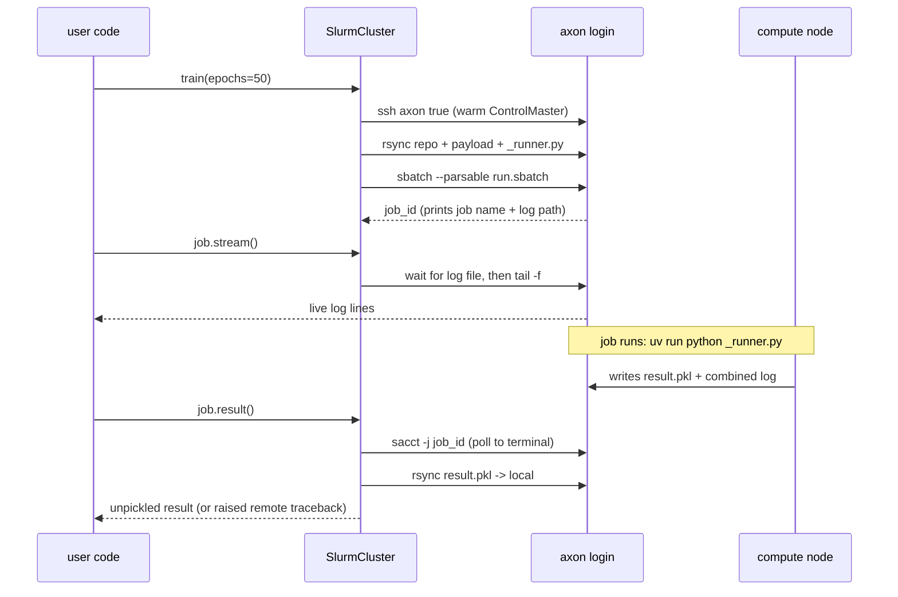

# `remoteexec` — Implementation Specification

> **Status:** Draft v0.3 — design proposal for review
> **Scope:** A lightweight Python library for editing code locally and executing it on a remote Slurm cluster, with a batteries-included, conda-first preset for the `axon` cluster.

This document is detailed enough to implement directly. Sections marked **[CONFIRM]** contain the few remaining assumptions; they're collected in *Open Questions* (§26).

### Changelog vs v0.2 (this revision)

- **Conda-first:** `CondaEnv` is the primary/default environment — `conda activate <name>` (conda module assumed loaded), with a `pre=[...]` list for extra pre-run commands (e.g. `module load cuda`) and an `init=True` escape hatch for the batch-shell activation gotcha. `UvEnv` and the rest remain available. (§10, §10.2)
- **Job-level `setup=[...]`:** arbitrary pre-run commands at cluster/decorator/call scope, composed before env activation. (§10.2, §13)
- **Correctness fixes (your point 3):** `local_dir` now defaults to the **detected project root** (walk up for `.git`/`pyproject.toml`/etc.), so the full repo is synced even when launched from a subdir/notebook; the trailing-slash rsync mirrors the root into the run's workdir; the job `cd`s into that mirror; and the runner is invoked by absolute path. Examples corrected to fetch per-run outputs via `job.fetch(...)` (not the project-root-relative `load_from_remote`). New §8.1 spells out the full sync/cwd/execution contract.
- **`remote_root`** stays `~/remoteexec`; no default partition.

### Changelog vs v0.1 (v0.2)

- **Connection:** `host` is the only required field; `user`/`port`/`identity_file` optional (SSH-config alias like `axon`). `--account`/`--qos` removed.
- **Paths as methods:** `cluster.make_path(...)`, `cluster.load_from_remote(...)`, `cluster.save_to_remote(...)`, returning a `RemotePath` handle.
- **Local execution:** a separate `local_env` + `is_remote()` for CPU-vs-GPU branching.
- **Self-contained remote runner** (only `cloudpickle` needed remotely).
- **Live logging:** single combined log file; `job.stream()` tails it live.

---

## 1. Goals and non-goals

### 1.1 Goals

1. Keep working in a **plain local folder** (need not be a git remote) while functions in it execute on a remote Slurm cluster.
2. **Clean decorators** that attach Slurm resource specs to a function.
3. Simple path/file APIs on the cluster object so a local Jupyter notebook can pull results produced remotely.
4. Stay **lightweight**: one required dependency (`cloudpickle`) + the system `ssh`/`rsync` binaries.
5. **Flexible** (`Cluster` abstraction) but with a one-line `AxonCluster` preset.

### 1.2 Non-goals

- Not a workflow/DAG engine, not a distributed-compute framework, not a container builder.
- No automatic cross-machine reproducibility — we make environment parity *easy*, not automatic.

### 1.3 Design principles

- **Explicit lifecycle:** pack → sync → submit → poll/stream → fetch.
- **Local-first debugging:** every remote function runs locally unchanged, optionally under a different local environment.
- **No daemons:** state lives in a remote session dir + a local manifest; a restarted notebook reattaches by job id.
- **No git dependency:** code ships via `rsync` with configurable excludes.
- **Cluster needs nothing installed but `cloudpickle`** (and not even that under `uv`).

---

## 2. Mental model

```
┌────────────────────────┐         ssh axon  (ControlMaster)   ┌──────────────────────────┐
│      LOCAL MACHINE      │  ───────────────────────────────►  │   AXON LOGIN NODE        │
│                         │         rsync over ssh              │                          │
│  your repo/  ───────────┼───────────── sync_up ─────────────►│  ~/remoteexec/<proj>/    │
│  @cluster.function fn   │                                     │     <session>/           │
│  job = fn(...)          │  ───── sbatch (combined log) ──────►│       payload.pkl        │
│  job.stream()           │  ◄──── job_id ─────────────────────│       _runner.py         │
│  job.result()           │  ◄──── tail -f  log ───────────────│       run.sbatch         │
│  cluster.load_from_     │                                     │       result.pkl         │
│      remote(...)   ◄────┼───────────── sync_down ────────────│       logs/<jobid>.out   │
└────────────────────────┘                                     └─────────────┬────────────┘
                                                                              │ sbatch
                                                                              ▼
                                                                     ┌──────────────────┐
                                                                     │  COMPUTE NODE(S) │
                                                                     │  uv run python   │
                                                                     │  _runner.py ...  │
                                                                     └──────────────────┘
```

Conceptually: **`submitit` + an SSH/rsync transport layer**, with the remote runner shipped as a standalone file so nothing but `cloudpickle` is needed on the cluster.

---

## 3. Installation and dependencies

### 3.1 Runtime requirements

- **Local:** Python ≥ 3.10; `ssh` and `rsync` on `PATH`. macOS/Linux first-class; Windows via WSL/Git-Bash.
- **Remote:** Slurm CLI (`sbatch`, `sacct`/`squeue`, `scancel`), plus *either* `uv` on `PATH` *or* an environment containing `cloudpickle`. The library copies its own `_runner.py` up, so `remoteexec` need not be installed remotely.

### 3.2 Python dependencies

| Dependency | Required? | Purpose |
|---|---|---|
| `cloudpickle` | **yes (local)** | Serialize functions/closures/args/results. |
| `tomli` | only on Py 3.10 | TOML config (`tomllib` is stdlib ≥ 3.11). |
| `typer` + `rich` | optional `[cli]` | The `remoteexec` CLI + pretty streaming. |
| `paramiko` | optional `[paramiko]` | Pure-Python SSH fallback. Default transport is subprocess `ssh`/`rsync`. |

### 3.3 `pyproject.toml` (sketch)

```toml
[project]
name = "remoteexec"
version = "0.2.0"
requires-python = ">=3.10"
dependencies = ["cloudpickle>=3.0", "tomli>=2.0; python_version < '3.11'"]

[project.optional-dependencies]
cli = ["typer>=0.12", "rich>=13"]
paramiko = ["paramiko>=3.4"]

[project.scripts]
remoteexec = "remoteexec.cli:app"

[tool.hatch.build.targets.wheel.force-include]
"remoteexec/_runner.py" = "remoteexec/_runner.py"   # ensure runner ships as data too
```

---

## 4. Package layout

```
remoteexec/
├── __init__.py          # public exports + is_remote()
├── config.py            # TOML config model + Cluster.from_config()
├── resources.py         # SlurmResources dataclass -> #SBATCH lines
├── environment.py       # Environment protocol; Uv/Conda/Venv/Module/Raw/Chain envs
├── connection.py        # SSHConnection: ssh/rsync/popen via subprocess + ControlMaster
├── paths.py             # RemotePath handle + quoting helpers
├── serialize.py         # pack_payload / load_result (cloudpickle)
├── templates.py         # sbatch script rendering
├── function.py          # RemoteFunction + @cluster.function decorator
├── job.py               # Job, JobArray, JobState, streaming
├── state.py             # local manifest (~/.remoteexec/manifest.json)
├── errors.py            # exception hierarchy
├── cli.py               # `remoteexec` CLI (optional extra)
├── _runner.py           # remote-side entrypoint — stdlib + cloudpickle only
└── clusters/
    ├── __init__.py
    ├── base.py          # Cluster ABC
    ├── slurm.py         # SlurmCluster (concrete)
    ├── local.py         # LocalCluster (subprocess, for tests/offline)
    └── presets.py       # AxonCluster preset
```

---

## 5. Public API surface

```python
from remoteexec import (
    SlurmCluster, LocalCluster,
    SlurmResources, Job, JobArray,
    is_remote,                          # device branching inside functions
    from_remote, to_remote,            # thin convenience wrappers over the methods
)
from remoteexec.environment import UvEnv, CondaEnv, VenvEnv, ModuleEnv, RawSetup, ChainEnv
from remoteexec.clusters.presets import AxonCluster
from remoteexec.errors import RemoteExecutionError, JobFailed, ConnectionError
```

### 5.1 Canonical usage (with `axon` + `conda`)

```python
from remoteexec import SlurmCluster, is_remote
from remoteexec.environment import CondaEnv

# host is the only required argument; everything else has a sensible default.
cluster = SlurmCluster(
    host="axon",                         # ~/.ssh/config alias — no user/password needed
    env=CondaEnv("torch24",              # remote: `conda activate torch24`
                 pre=["module load cuda/12.1"]),   # optional extra pre-run commands
    local_env=CondaEnv("torch-cpu"),     # optional: a different env for local test runs
    default_resources=dict(time="04:00:00", cpus_per_task=8, mem="32G"),
)
# remote_root defaults to "~/remoteexec"; project defaults to the project-root folder name.

@cluster.function(gpus=1, mem="48G", time="08:00:00", name="train")
def train(epochs: int, lr: float = 1e-3):
    import torch, json, pathlib
    device = "cuda" if is_remote() else "cpu"      # GPU remotely, CPU locally
    ...
    pathlib.Path("outputs").mkdir(exist_ok=True)   # written under this run's workdir
    json.dump(metrics, open("outputs/metrics.json", "w"))
    return {"best_acc": best_acc}

job = train(epochs=50, lr=3e-4)          # syncs repo, submits via sbatch, returns Job
# -> prints: submitted 'train' as job 1234567   log: axon:~/remoteexec/.../logs/1234567.out

job.stream()                             # live tail of the combined log until the job ends
metrics = job.result()                   # pulls result.pkl, unpickles, re-raises on error

out_dir = job.fetch("outputs/")          # rsync THIS run's outputs back -> local Path
# (use cluster.load_from_remote(...)/make_path(...) for durable, project-root-relative data)
```

### 5.2 Local test run (CPU), same code

```python
metrics = train.local(epochs=2, lr=3e-4)     # runs locally; is_remote() -> False
# uses cluster.local_env if set (subprocess), else runs in-process for speed.
```

### 5.3 Preset

```python
from remoteexec.clusters.presets import AxonCluster
cluster = AxonCluster(conda_env="torch24")   # host/root/defaults pre-baked
```

---

## 6. `Cluster` abstraction — `clusters/base.py`

```python
class Cluster(ABC):
    # decorator factory
    def function(self, *, name=None, env=None, setup=None, run_local=False,
                 sync=True, **resource_kwargs) -> Callable[[Callable], "RemoteFunction"]: ...

    # submission
    @abstractmethod
    def submit(self, fn, args, kwargs, resources, *, env=None, name=None,
               sync=True) -> "Job": ...
    @abstractmethod
    def map(self, fn, iterable, *, resources, **kw) -> "JobArray": ...

    # job control
    @abstractmethod
    def status(self, job_id) -> "JobState": ...
    @abstractmethod
    def cancel(self, job_id) -> None: ...
    @abstractmethod
    def job(self, job_id) -> "Job": ...               # rebuild handle from manifest

    # paths & transfer  (the method-based API you asked for)
    @abstractmethod
    def make_path(self, *parts, mkdir=True) -> "RemotePath": ...
    @abstractmethod
    def load_from_remote(self, remote, local=None) -> Path: ...
    @abstractmethod
    def save_to_remote(self, local, remote) -> "RemotePath": ...
```

---

## 7. Connection layer — `connection.py`

### 7.1 SSH-config-first, everything optional

```python
@dataclass
class SSHConnection:
    host: str                            # the only required field (e.g. "axon")
    user: str | None = None              # optional; omit to rely on ~/.ssh/config
    port: int | None = None              # optional
    identity_file: str | None = None     # optional
    control_dir: Path = Path("~/.remoteexec/cm").expanduser()
    control_persist: str = "10m"
    connect_timeout: int = 20
    extra_ssh_opts: list[str] = field(default_factory=list)

    def target(self) -> str:
        return f"{self.user}@{self.host}" if self.user else self.host   # "axon"

    def _base_opts(self) -> list[str]:
        sock = self.control_dir / f"{self.host}-{self.port or 22}"
        opts = ["-o", "ControlMaster=auto", "-o", f"ControlPath={sock}",
                "-o", f"ControlPersist={self.control_persist}",
                "-o", f"ConnectTimeout={self.connect_timeout}"]
        if self.port: opts += ["-p", str(self.port)]
        if self.identity_file: opts += ["-i", self.identity_file]
        return opts + self.extra_ssh_opts

    def run(self, cmd, *, check=True, timeout=None) -> "CompletedRun":
        argv = ["ssh", *self._base_opts(), self.target(), cmd]; ...   # subprocess.run

    def popen(self, cmd) -> subprocess.Popen:          # for `tail -f` streaming
        return subprocess.Popen(["ssh", *self._base_opts(), self.target(), cmd],
                                stdout=subprocess.PIPE, text=True, bufsize=1)

    def exists(self, remote_path) -> bool:
        return self.run(f"test -e {rq(remote_path)}", check=False).returncode == 0

    def rsync(self, src, dst, *, up, excludes=(), delete=False, extra=()):
        ssh_cmd = "ssh " + " ".join(shlex.quote(o) for o in self._base_opts())
        argv = ["rsync", "-az", "--info=progress2", "-e", ssh_cmd]
        for e in excludes: argv += ["--exclude", e]
        if delete: argv.append("--delete")
        argv += list(extra)
        argv += ([src, f"{self.target()}:{dst}"] if up
                 else [f"{self.target()}:{src}", dst])
        ...

    def open(self): self.run("true")        # warms ControlMaster (one-time auth if any)
```

For `axon`, construction is just `SSHConnection(host="axon")` and every call becomes `ssh axon …` / `rsync … axon:…`.

> **Remote-path quoting (`rq`)** lives in `paths.py`. It must let `$VAR` and a leading `~` expand on the remote while protecting spaces. Strategy: if the path matches `^[~$A-Za-z0-9_./%-]+$`, emit it unquoted (so the remote shell expands `$SCRATCH`/`~`); otherwise fall back to a safe `"..."` wrapping that escapes `"`, `` ` ``, `\`. Unit-tested against `~/x`, `$SCRATCH/a b`, `/abs/p`.

### 7.2 Notebook + interactive auth

If your SSH setup ever prompts (it won't for key-only `axon`), do it once in a terminal — `remoteexec connect axon` warms the ControlMaster socket that the notebook then reuses. For a pure key-based alias this is a no-op.

---

## 8. Paths & transfer — `paths.py` + cluster methods

You asked for path setup as cluster methods returning a handle. The handle is `RemotePath`.

```python
@dataclass(frozen=True)
class RemotePath:
    cluster: "SlurmCluster"
    path: str                              # remote-absolute (or $VAR/~ rooted) string
    def __str__(self): return self.path
    def __fspath__(self): return self.path
    def __truediv__(self, other): return RemotePath(self.cluster, f"{self.path}/{other}")
    def fetch(self, local=None) -> Path: return self.cluster.load_from_remote(self.path, local)
    def push(self, local) -> "RemotePath": return self.cluster.save_to_remote(local, self.path)
    def exists(self) -> bool: return self.cluster.conn.exists(self.path)
```

Cluster-side methods:

```python
def _resolve(self, p: str) -> str:
    """Absolute (/...), home (~...), or var ($...) paths pass through;
    everything else is relative to the project root."""
    return p if p[:1] in ("/", "~", "$") else f"{self.project_root}/{p}"

def make_path(self, *parts, mkdir=True) -> RemotePath:
    remote = self._resolve("/".join(str(p) for p in parts))
    if mkdir:
        self.connect(); self.conn.run(f"mkdir -p {rq(remote)}")
    return RemotePath(self, remote)

def load_from_remote(self, remote, local=None) -> Path:
    self.connect()
    remote_abs = self._resolve(str(remote))
    dst = Path(local or (Path.cwd() / Path(remote_abs).name)).expanduser()
    dst.parent.mkdir(parents=True, exist_ok=True)
    self.conn.rsync(remote_abs, str(dst), up=False)
    return dst

def save_to_remote(self, local, remote) -> RemotePath:
    self.connect()
    remote_abs = self._resolve(str(remote))
    self.conn.run(f"mkdir -p {rq(str(Path(remote_abs).parent))}")
    self.conn.rsync(str(Path(local).expanduser()), remote_abs, up=True)
    return RemotePath(self, remote_abs)
```

Usage:

```python
runs = cluster.make_path("experiments", "sweep1")     # ~/remoteexec/<proj>/experiments/sweep1 (mkdir -p)
runs.push("local_config.yaml")                         # rsync up
durable = cluster.load_from_remote("experiments/sweep1/")  # project-root-relative -> Path
local_ckpt = (runs / "best.pt").fetch("ckpts/best.pt") # handle-based fetch
```

`make_path` and `cluster.load_from_remote(...)` resolve **relative to the project root** (`~/remoteexec/<proj>`) and are for **durable, cross-run** data. To pull the artifacts a *single run* wrote into its own working dir, use `job.fetch(...)` (§15), which resolves against that run's session dir.

The free functions are kept for the one-liner notebook style from your original sketch:

```python
def from_remote(cluster, remote, local=None): return cluster.load_from_remote(remote, local)
def to_remote(cluster, local, remote):        return cluster.save_to_remote(local, remote)
```

Sync-up excludes default to `[".git/","__pycache__/","*.pyc",".venv/","node_modules/",
".ipynb_checkpoints/",".remoteexec/","*.egg-info/",".mypy_cache/",".DS_Store"]`, plus `.gitignore`
entries when that file is present (git not required), plus any user `excludes`. Code sync uses
`delete=False` so remote-produced artifacts survive re-syncs.

### 8.1 What gets pushed, where the cwd is, and what runs (your point 3)

This subsection makes the sync/cd contract explicit, because getting it subtly wrong is the easiest way to "run the wrong file."

**1. The full project root is pushed — even from a subdirectory or notebook.**
`local_dir` no longer defaults to the raw CWD. It defaults to the **detected project root**: starting at CWD, walk upward to the first directory containing any of `.git/`, `pyproject.toml`, `setup.py`, `setup.cfg`, or `remoteexec.toml`; if none is found, fall back to CWD. You can always override with `SlurmCluster(..., local_dir="/path/to/repo")`.

```python
def find_project_root(start: Path) -> Path:
    start = start.resolve()
    markers = {".git", "pyproject.toml", "setup.py", "setup.cfg", "remoteexec.toml"}
    for d in (start, *start.parents):
        if any((d / m).exists() for m in markers):
            return d
    return start
```

So whether you launch from `repo/`, `repo/notebooks/analysis.ipynb`, or `repo/src/`, the **entire `repo/` tree** is what ships — not just the subfolder you happened to be in.

**2. The push lands at the run's working dir, mirroring the root.**
`sync_up` calls `rsync -az "{local_dir}/" "{workdir}"` — the **trailing slash on the source is required** and means "copy the *contents* of the project root into `{workdir}`", so `{workdir}` becomes a faithful mirror of the repo root (`{workdir}/src/...`, `{workdir}/data/...`, `{workdir}/pyproject.toml`, ...). Here `{workdir} = ~/remoteexec/<project>/<session>`.

**3. The job runs *from* that mirrored root, and the runner is invoked by absolute path.**
The generated sbatch script does, in order: `cd {workdir}` → `export PYTHONPATH="{workdir}:$PYTHONPATH"` → `{launcher} {workdir}/_runner.py {workdir}/payload.pkl {workdir}/result.pkl`. Consequences:
   - The **remote cwd is the mirror of your project root**, so relative paths in your function (`open("data/x.csv")`, `Path("outputs").mkdir()`) resolve exactly as they would locally when run from the project root.
   - Because the root is on `PYTHONPATH`, functions you **import from your package** (e.g. `from src.train import run`) re-import correctly remotely — cloudpickle ships them *by reference* and the dotted module path resolves from the root. Functions defined in your `__main__` script or in a **notebook** are shipped *by value* (closure included), so they don't need to be importable at all.
   - The runner is referenced by its absolute `{workdir}/_runner.py` path, so "the correct file is executed" does not depend on cwd — `cd {workdir}` is purely so *your* code's relative paths behave like local.

**The one assumption to be aware of:** your function's relative paths and imports are interpreted as if **cwd = project root**. Locally this means: run your scripts/notebooks expecting the repo root as cwd (which the auto-detected `local_dir` mirrors remotely). If you instead rely on being inside a subdirectory locally, set `local_dir` to that subdirectory (it then becomes the synced+cwd root remotely) so the two stay consistent. The library logs the resolved root at submit time: `[remoteexec] project root: /Users/you/repo -> axon:~/remoteexec/repo/<session>`.

---

## 9. Resource specification — `resources.py`

```python
@dataclass
class SlurmResources:
    partition: str | None = None
    nodes: int | None = None
    ntasks: int | None = None
    cpus_per_task: int | None = None
    gpus: int | str | None = None          # 1  or  "a100:2"
    mem: str | None = None
    mem_per_cpu: str | None = None
    time: str | None = None
    constraint: str | None = None
    nodelist: str | None = None
    exclude: str | None = None
    array: str | None = None               # set automatically by .map()
    job_name: str | None = None
    extra_directives: list[str] = field(default_factory=list)
    # NOTE: no account/qos — you never use them. Add via extra_directives if ever needed.

    def merge(self, other) -> "SlurmResources": ...   # cluster defaults < decorator < per-call
    def to_sbatch_lines(self) -> list[str]: ...        # emits #SBATCH --flag=value (gpus -> --gres=gpu:N)
```

> **On "job id":** a Slurm job id is assigned at submission, so it's an output (`job.job_id`), not a decorator field. The decorator carries `name` (→ `--job-name`) and the resource fields above.

**Layering:** `cluster.default_resources` ◄ decorator kwargs ◄ per-call `_resources={...}`. Reserved per-call kwargs (`_resources`, `_name`, `_env`) are stripped before packing the function args.

---

## 10. Environments — `environment.py`

Each strategy yields (a) a bash activation snippet and (b) the python launcher to invoke the runner. **`CondaEnv` is the primary/default strategy** (easiest to get builds right on axon); `UvEnv` and the others remain available.

```python
class Environment(Protocol):
    def activation_script(self) -> str: ...
    def launcher(self) -> str: return "python"      # only UvEnv overrides this
```

The `pre` field on `CondaEnv` (and the cluster/decorator-level `setup=[...]`, §10.2) is where arbitrary **pre-run commands** go — extra `module load`s, `export`s, etc. — emitted before activation.

```python
@dataclass
class UvEnv:
    project_dir: str | None = None         # defaults to the synced workdir (cwd at run time)
    python: str | None = None              # e.g. "3.11" — uv fetches it if missing
    sync: bool = True
    frozen: bool = True
    with_packages: tuple[str, ...] = ("cloudpickle",)   # injected ephemerally for the runner
    preamble: str = ""                     # uv is on PATH on axon -> no preamble needed
    def activation_script(self) -> str:
        lines = [self.preamble] if self.preamble else []
        if self.sync:
            cmd = "uv sync --frozen" if self.frozen else "uv sync"
            lines.append(f"cd {self.project_dir} && {cmd}" if self.project_dir else cmd)
        return "\n".join(lines)
    def launcher(self) -> str:
        py  = f"--python {self.python} " if self.python else ""
        wth = " ".join(f"--with {p}" for p in self.with_packages)
        return f"uv run {py}{wth} python".strip().replace("  ", " ")

@dataclass
class ModuleEnv:
    modules: list[str]
    def activation_script(self): return "\n".join(f"module load {m}" for m in self.modules)

@dataclass
class CondaEnv:
    """Primary environment for axon. Activation is simply `conda activate <name>`,
    assuming the conda module is already loaded (conda on PATH)."""
    name: str
    pre: list[str] = field(default_factory=list)   # extra pre-run commands, e.g.
                                                    #   ["module load cuda/12.1", "export OMP_NUM_THREADS=8"]
    init: bool = False                              # if `conda activate` fails in a batch shell,
                                                    # set True to emit `eval "$(conda shell.bash hook)"` first
    def activation_script(self) -> str:
        lines = list(self.pre)
        if self.init:
            lines.append('eval "$(conda shell.bash hook)"')
        lines.append(f"conda activate {self.name}")
        return "\n".join(lines)
    # launcher() defaults to "python" — cloudpickle must be in the conda env.

@dataclass
class VenvEnv:
    path: str
    def activation_script(self): return f"source {self.path}/bin/activate"

@dataclass
class RawSetup:
    script: str = ""
    def activation_script(self): return self.script      # default = no-op activation

@dataclass
class ChainEnv:                                          # e.g. module load THEN conda activate
    parts: list[Environment]
    def activation_script(self): return "\n".join(p.activation_script() for p in self.parts)
    def launcher(self):                                  # last part wins (e.g. a UvEnv tail)
        for p in reversed(self.parts):
            if hasattr(p, "launcher"): return p.launcher()
        return "python"
```

**Why `uv run --with cloudpickle`:** the remote runner is a standalone file needing only `cloudpickle`. `--with` layers it on ephemerally, so your project's `pyproject.toml`/`uv.lock` need not list it, and `remoteexec` need not be installed on the cluster at all. For conda/venv/module envs, `cloudpickle` must be present in that env.

### 10.1 Local vs remote environments (CPU vs GPU testing)

- `cluster.env` is the **remote** environment; `cluster.local_env` is the optional **local** one.
- `fn.local(...)`:
  - if `cluster.local_env` (or a per-call `env=`) is set → runs via the **same** pack→runner→load machinery in a local subprocess, with that env activated (a different uv project, a CPU conda env, etc.);
  - else → runs **in-process** (fastest path for quick iteration).
- Inside the function, `remoteexec.is_remote()` distinguishes the two so you can pick `cuda` vs `cpu`, batch sizes, dataset subsets, etc. The remote sbatch script exports `REMOTEEXEC_REMOTE=1`; local runs leave it unset/`0`.

```python
def is_remote() -> bool:
    import os
    return os.environ.get("REMOTEEXEC_REMOTE") == "1"
```

This is the clean answer to "cluster has GPU but local has CPU": one function, two environments, branch on `is_remote()`.

### 10.2 Pre-run commands and the conda-activation gotcha

There are two layers for injecting extra shell commands before your code runs, composed in this order in the sbatch script:

```bash
{setup commands}            # cluster.setup + decorator/per-call setup=[...]  (job-level)
{env.activation_script()}   # e.g. CondaEnv.pre, then `conda activate <name>` (env-level)
```

- **Env-level (`CondaEnv.pre`)** — commands tied to the environment itself (e.g. `module load cuda/12.1` that the env always needs). Lives with the env so it travels wherever that env is used.
- **Job-level (`setup=`)** — a `list[str]` accepted by `SlurmCluster(setup=...)`, `@cluster.function(setup=...)`, and per-call. For one-off tweaks (`export WANDB_MODE=offline`, `module load a-different-thing`) without redefining the env.

```python
@cluster.function(setup=["export OMP_NUM_THREADS=8", "module load ffmpeg"], name="render")
def render(...): ...
```

**Conda activation in batch shells.** `conda activate <name>` relies on a shell function that interactive logins set up but a fresh non-interactive `sbatch` shell sometimes does not — even when `conda` is on `PATH`. We emit the bare `conda activate <name>` you asked for by default. If a job ever fails early with `CommandNotFoundError: ... conda init` (or similar), flip `CondaEnv(name, init=True)`; that prepends `eval "$(conda shell.bash hook)"`, which defines the function in any shell where `conda` is on `PATH`. It's off by default to keep the script minimal, on by one flag if your cluster needs it.

---

## 11. Serialization — `serialize.py`

```python
def pack_payload(fn, args, kwargs) -> bytes:
    import cloudpickle
    return cloudpickle.dumps({"fn": fn, "args": args, "kwargs": kwargs,
                              "remoteexec_version": __version__})

def load_result(path: Path):
    import cloudpickle
    out = cloudpickle.load(open(path, "rb"))
    if out["status"] == "ok": return out["result"]
    raise RemoteExecutionError(out["exc_type"], out["traceback"], out.get("exception"))
```

- Functions defined in your **synced repo** pickle *by reference* and re-import remotely (repo is on `PYTHONPATH`) — tiny payloads, edits take effect next submission.
- Functions/lambdas defined in a **notebook** pickle *by value* (closure included).
- Return values are unpickled locally → their types must be importable on both ends. For large artifacts, **write to disk remotely and `load_from_remote`** instead of returning them.

---

## 12. Remote runner — `_runner.py` (shipped as a standalone file)

Copied into each session dir (via `importlib.resources`), invoked by path, so the cluster needs no `remoteexec` install. Imports stdlib + `cloudpickle` only.

```python
import os, sys, pickle, traceback

def main():
    import cloudpickle
    payload_path, result_path = sys.argv[1], sys.argv[2]
    payload = cloudpickle.load(open(payload_path, "rb"))
    fn, args, kwargs = payload["fn"], payload["args"], payload["kwargs"]
    try:
        out = {"status": "ok", "result": fn(*args, **kwargs)}
    except BaseException as e:                       # capture everything
        out = {"status": "error", "exc_type": type(e).__name__,
               "traceback": traceback.format_exc(), "exception": _safe(e)}
    tmp = result_path + ".tmp"
    cloudpickle.dump(out, open(tmp, "wb")); os.replace(tmp, result_path)   # atomic publish
    sys.exit(0 if out["status"] == "ok" else 1)

def _safe(exc):
    try: pickle.loads(pickle.dumps(exc)); return exc
    except Exception: return None                   # traceback string is always kept

if __name__ == "__main__":
    main()
```

The same file is reused for local subprocess runs (`fn.local()` with a `local_env`).

---

## 13. sbatch template — `templates.py` (single combined log)

```python
SBATCH_TEMPLATE = """#!/bin/bash
{sbatch_directives}
#SBATCH --output={logdir}/%j.out
# (no --error: stderr is merged into the same file -> everything in one log)

set -euo pipefail
echo "[remoteexec] host=$(hostname) job=${{SLURM_JOB_ID}} start=$(date -Is)"

{setup}                       # job-level pre-run commands (cluster.setup + setup=[...])
{env_activation}              # env-level: CondaEnv.pre, then `conda activate <name>`

cd {workdir}
export PYTHONPATH="{workdir}:${{PYTHONPATH:-}}"
export REMOTEEXEC_REMOTE=1

rc=0
{launcher} {workdir}/_runner.py {payload_path} {result_path} || rc=$?
echo "[remoteexec] end=$(date -Is) rc=${{rc}}"
exit ${{rc}}
"""
```

- `{sbatch_directives}` = joined `SlurmResources.to_sbatch_lines()`.
- `{setup}` = `"\n".join(cluster.setup + decorator_setup + call_setup)` — job-level pre-run commands.
- `{env_activation}` = `env.activation_script()` (e.g. `conda activate torch24`, with any `CondaEnv.pre` first).
- `{launcher}` = `env.launcher()` (`"python"` for conda/venv/module; `"uv run --with cloudpickle python"` for `UvEnv`).
- `cd {workdir}` makes the remote cwd the mirror of your project root (§8.1); the runner is still referenced by absolute path so execution doesn't depend on cwd.
- Omitting `--error` puts stdout **and** stderr into one file — the "pipe everything to an output file" behavior `job.stream()` tails.
- `|| rc=$?` captures the runner's exit code under `set -e` so the job's Slurm state reflects success/failure.

**Job arrays** (`.map`) index payloads/results by `${SLURM_ARRAY_TASK_ID}`:

```bash
{launcher} {workdir}/_runner.py {workdir}/payloads/${{SLURM_ARRAY_TASK_ID}}.pkl \
                                {workdir}/results/${{SLURM_ARRAY_TASK_ID}}.pkl || rc=$?
```

---

## 14. Submission lifecycle — `clusters/slurm.py`

### 14.1 `SlurmCluster.__init__` (defaults)

```python
class SlurmCluster(Cluster):
    def __init__(self, host, *, user=None, port=None, identity_file=None,
                 remote_root="~/remoteexec", project=None, local_dir=None,
                 env=None, local_env=None, default_resources=None, setup=(),
                 excludes=(), respect_gitignore=True):
        self.conn = SSHConnection(host, user=user, port=port, identity_file=identity_file)
        # local_dir defaults to the DETECTED PROJECT ROOT (walk up from CWD), not raw CWD,
        # so the full repo is synced even when launched from a subdir/notebook (§8.1).
        self.local_dir = Path(local_dir).resolve() if local_dir else find_project_root(Path.cwd())
        self.remote_root = remote_root                       # default ~/remoteexec
        self.project = project or self.local_dir.name        # default = project-root folder name
        self.env = env or RawSetup("")                       # default no-op activation
        self.local_env = local_env
        self.setup = list(setup)                             # job-level pre-run commands
        self.default_resources = SlurmResources(**(default_resources or {}))
        self.excludes = list(excludes); self.respect_gitignore = respect_gitignore

    @property
    def project_root(self) -> str: return f"{self.remote_root}/{self.project}"
```

So `SlurmCluster(host="axon")` is fully valid. `host` is the only thing you must supply. `local_dir` is auto-detected as the project root; override it if you want a different sync/cwd root.

### 14.2 `submit()` (pseudocode)

```python
def submit(self, fn, args, kwargs, resources, *, env=None, name=None,
           setup=(), sync=True) -> Job:
    self.connect()
    session = new_session_id()                       # e.g. 20260617-1432-ab12cd
    workdir = f"{self.project_root}/{session}"; logdir = f"{workdir}/logs"
    self.conn.run(f"mkdir -p {rq(logdir)}")

    if sync:
        log.info("project root: %s -> %s:%s", self.local_dir, self.conn.target(), workdir)
        sync_up(self.conn, self.local_dir, workdir,      # rsync "{local_dir}/" -> workdir (full repo)
                excludes=self.excludes, respect_gitignore=self.respect_gitignore)
    upload_bytes(self.conn, pack_payload(fn, args, kwargs), f"{workdir}/payload.pkl")
    upload_runner(self.conn, f"{workdir}/_runner.py")          # bundled standalone file

    eff = self.default_resources.merge(resources)
    eff.job_name = eff.job_name or name or fn.__name__
    use_env = env or self.env
    script = render_sbatch(eff, env=use_env, setup=[*self.setup, *setup],
                           workdir=workdir, logdir=logdir,
                           payload_path=f"{workdir}/payload.pkl",
                           result_path=f"{workdir}/result.pkl")
    upload_text(self.conn, script, f"{workdir}/run.sbatch")

    job_id = self.conn.run(f"sbatch --parsable {rq(workdir)}/run.sbatch").stdout.split(";")[0].strip()

    job = Job(self, job_id=job_id, session=session, workdir=workdir, logdir=logdir,
              name=eff.job_name)
    state.record(job)
    log.info("submitted %r as job %s\n         log:    %s:%s/%s.out"
             "\n         stream: job.stream()    cli: remoteexec logs %s -f",
             eff.job_name, job_id, self.conn.target(), logdir, job_id, job_id)
    return job
```

The two `log.info` lines satisfy the "tell me the project root, slurm job name, output file, etc." requirement; they print to stderr by default and are visible in notebooks.

### 14.3 Sequence



---

## 15. Job handle & live logging — `job.py`

```python
class JobState(str, Enum):
    PENDING="PENDING"; RUNNING="RUNNING"; COMPLETED="COMPLETED"
    FAILED="FAILED"; CANCELLED="CANCELLED"; TIMEOUT="TIMEOUT"; UNKNOWN="UNKNOWN"
TERMINAL = {JobState.COMPLETED, JobState.FAILED, JobState.CANCELLED, JobState.TIMEOUT}

@dataclass
class Job:
    cluster: "SlurmCluster"; job_id: str; session: str
    workdir: str; logdir: str; name: str

    @property
    def logfile(self) -> str: return f"{self.logdir}/{self.job_id}.out"

    def state(self) -> JobState: ...        # sacct -j --format=State -Pn  (fallback squeue)
    def done(self) -> bool: return self.state() in TERMINAL
    def wait(self, poll=10.0, timeout=None) -> JobState: ...   # backoff to terminal

    def result(self, **wait_kw):
        st = self.wait(**wait_kw)
        if st is not JobState.COMPLETED:
            raise JobFailed(state=st, log_tail=self.logs(tail=60))
        local = self.cluster.load_from_remote(f"{self.workdir}/result.pkl",
                                              _scratch_local(self.job_id))
        return load_result(local)

    def logs(self, tail: int | None = None) -> str:           # combined stdout+stderr
        c = f"tail -n {tail} {rq(self.logfile)}" if tail else f"cat {rq(self.logfile)}"
        return self.cluster.conn.run(c, check=False).stdout

    def stream(self, follow: bool = True, poll: float = 3.0) -> None:
        """Live-tail the combined log to local stdout until the job is terminal."""
        conn = self.cluster.conn; self.cluster.connect()
        while not conn.exists(self.logfile):
            if self.done(): print(self.logs() or "(no output)"); return
            time.sleep(poll)
        if not follow: print(self.logs()); return
        proc = conn.popen(f"tail -n +1 -f {rq(self.logfile)}")
        try:
            terminated_at = None
            while True:
                line = proc.stdout.readline()
                if line: print(line, end="")
                elif terminated_at is None and self.done(): terminated_at = time.time()
                elif terminated_at and time.time() - terminated_at > 3: break
                else: time.sleep(0.2)
        finally:
            proc.terminate()

    def fetch(self, remote_subpath, local=None) -> Path:
        return self.cluster.load_from_remote(f"{self.workdir}/{remote_subpath}", local)
    def cancel(self) -> None: self.cluster.cancel(self.job_id)


class JobArray:
    jobs: list[Job]
    def wait(self): ...
    def results(self) -> list: ...
    def stream(self, task: int = 0): self.jobs[task].stream()
```

**Streaming design notes:** the combined log file only appears once the job starts, so `stream()` first polls for the file (or early-exits if the job already finished). It then `tail -f`s over the ControlMaster socket and stops a few seconds after the job reaches a terminal state, so it doesn't hang forever on `tail -f`.

---

## 16. `map` / job arrays

```python
arr = train.map([{"epochs": e} for e in (10, 20, 40)], _resources={"array_throttle": 2})
results = arr.results()        # aligned to the input order
arr.stream(task=0)             # follow one task's log
```

One payload pickle per task under `workdir/payloads/<i>.pkl`, a single `--array=0-(n-1)[%throttle]` submission, results gathered from `workdir/results/<i>.pkl`.

---

## 17. Configuration — `config.py`

Search order: explicit `from_config(name)` → `./remoteexec.toml` → `~/.config/remoteexec/config.toml` → `[tool.remoteexec]` in `pyproject.toml`. All fields optional except `host`.

```toml
# remoteexec.toml
default = "axon"

[clusters.axon]
host = "axon"                 # ssh alias; no user/port/key needed
# remote_root defaults to "~/remoteexec"; project defaults to the folder name
excludes = ["data/raw/", "*.ckpt", "wandb/"]

[clusters.axon.env]          # remote environment (conda is primary)
kind = "conda"
name = "torch24"             # -> conda activate torch24  (conda module assumed loaded)
pre  = ["module load cuda/12.1"]   # optional extra pre-run commands
# init = true                # set if `conda activate` fails in a batch shell

[clusters.axon.local_env]    # optional: used by fn.local()
kind = "conda"
name = "torch-cpu"

setup = ["export WANDB_MODE=offline"]   # optional job-level pre-run commands (cluster-wide)

[clusters.axon.default_resources]
time = "04:00:00"
cpus_per_task = 8
mem = "32G"
# no account / qos
```

```python
cluster = SlurmCluster.from_config()          # the default ("axon")
```

---

## 18. The `axon` preset — `clusters/presets.py`

```python
class AxonCluster(SlurmCluster):
    """Preset for the `axon` Slurm cluster (ssh alias `axon`). Conda-first."""
    def __init__(self, *, conda_env: str = "base", pre: list[str] | None = None,
                 local_conda_env: str | None = None, env=None,
                 project=None, local_dir=None, setup=(), **overrides):
        # `env=` (an Environment) wins if given; otherwise build a CondaEnv from conda_env/pre.
        remote_env = env or CondaEnv(conda_env, pre=pre or [])
        local_env  = (CondaEnv(local_conda_env) if local_conda_env else None)
        super().__init__(
            host="axon",
            remote_root="~/remoteexec",            # home, per your choice
            project=project, local_dir=local_dir,
            env=remote_env,
            local_env=local_env,
            setup=setup,
            default_resources=dict(time="04:00:00", cpus_per_task=8, mem="32G"),
            # no account / qos; no default partition
            excludes=["data/raw/", "*.ckpt", "wandb/"],
            **overrides,
        )
```

Usage:

```python
cluster = AxonCluster(conda_env="torch24")                       # conda activate torch24
cluster = AxonCluster(conda_env="torch24",
                      pre=["module load cuda/12.1"],             # extra pre-run command(s)
                      local_conda_env="torch-cpu")               # different env for fn.local()
cluster = AxonCluster(env=UvEnv())                               # opt back into uv if ever wanted
```

The conda module is assumed already loaded (conda on `PATH`). If `conda activate` ever fails in a batch shell, pass `env=CondaEnv("torch24", init=True)` (see §10.2).

---

## 19. CLI — `cli.py` (optional `[cli]` extra)

```
remoteexec connect [CLUSTER]               # warm ControlMaster (no-op for key-only axon)
remoteexec logs    JOB_ID [-f]             # print or live-stream the combined log
remoteexec status  [JOB_ID] [--cluster C]  # one job, or all tracked jobs
remoteexec fetch   JOB_ID REMOTE [LOCAL]
remoteexec cancel  JOB_ID
remoteexec ls                              # tracked jobs from the local manifest
remoteexec clean   [--older-than 7d]       # prune old remote session dirs
```

`remoteexec logs <id> -f` is the terminal equivalent of `job.stream()`.

---

## 20. Local state — `state.py`

JSON manifest at `~/.remoteexec/manifest.json`: `job_id → {cluster_host, session, workdir, logdir, name, submitted_at}`. Enables `cluster.job("1234567")` to rebuild a `Job` after a notebook restart, powers the CLI, and lets `clean` prune old session dirs. Writes are atomic (`os.replace`) with a best-effort file lock.

---

## 21. Error handling — `errors.py`

```python
class RemoteExecError(Exception): ...
class ConnectionError(RemoteExecError): ...
class TransferError(RemoteExecError): ...
class RemoteCommandError(RemoteExecError): ...
class SubmissionError(RemoteExecError): ...
class JobFailed(RemoteExecError):            # non-COMPLETED terminal (OOM/TIMEOUT/cancel/node fail)
    state: JobState; log_tail: str
class RemoteExecutionError(RemoteExecError): # the function itself raised
    exc_type: str; remote_traceback: str
    def __str__(self): return f"{self.exc_type} on cluster:\n{self.remote_traceback}"
```

`result()` raises `RemoteExecutionError` (re-surfacing the remote traceback) when your function threw, and `JobFailed` (with a log tail) when Slurm killed it — so the two are distinguishable.

---

## 22. Security & safety

- Auth delegated entirely to `ssh`/`~/.ssh/config`; no credentials ever embedded in commands.
- Remote paths quoted via `rq` (expands `$VAR`/`~`, protects spaces); payloads travel as files, never as shell args.
- `set -euo pipefail` + explicit `rc` capture in every sbatch script.
- The library executes only scripts it generates; it does not interpret instructions found in fetched files.
- Default `remote_root=~/remoteexec`; document `clean` and the option to point at scratch if home quota is tight.

---

## 23. Testing strategy

| Layer | How |
|---|---|
| Unit | resource rendering, template rendering, `rq` quoting (`~/x`, `$SCRATCH/a b`, `/abs`), gitignore parsing, config defaults (host-only construction), manifest atomicity. |
| Connection | mock `subprocess`; assert exact `ssh axon …` / `rsync … axon:…` argv incl. ControlMaster opts. |
| Local integration | `LocalCluster` + `fn.local()` run the real pack→runner→load path in a subprocess; verify `is_remote()`, atomic results, exception re-raise, and `local_env` activation. |
| Slurm integration | optional CI against a containerized Slurm reachable over ssh; gated by env flag. |
| E2E checklist (axon) | submit, stream, array, OOM, timeout, cancel, fetch, reattach-from-manifest, uv-vs-conda env. |

---

## 24. Worked examples

### 24.1 Notebook: remote GPU train, local plotting

```python
from remoteexec import SlurmCluster, is_remote
from remoteexec.environment import CondaEnv

cluster = SlurmCluster(host="axon",
                       env=CondaEnv("torch24", pre=["module load cuda/12.1"]),
                       local_env=CondaEnv("torch-cpu"))

@cluster.function(gpus=1, mem="48G", time="06:00:00", name="vit")
def train(depth: int, seed: int):
    import torch, pathlib
    device = "cuda" if is_remote() else "cpu"
    metrics = run_training(depth=depth, seed=seed, device=device)   # imported from synced repo
    pathlib.Path("outputs").mkdir(exist_ok=True)                    # under this run's workdir
    torch.save(state_dict, f"outputs/vit_d{depth}_s{seed}.pt")
    return metrics

# quick local smoke test on CPU before burning GPU hours:
_ = train.local(depth=2, seed=0)

jobs = [train(depth=d, seed=0) for d in (6, 12, 24)]
jobs[0].stream()                                   # watch the first run live

import pandas as pd
df = pd.DataFrame([j.result() for j in jobs])
ckpts = [j.fetch("outputs/") for j in jobs]        # each run's outputs/ (per-run workdir)
df.plot(x="depth", y="val_acc")
```

> Note the difference: `job.fetch("outputs/")` pulls what *that run* wrote into its own session dir (correct for per-run artifacts). `cluster.load_from_remote("...")`/`make_path(...)` are for durable, project-root-relative data shared across runs (§8.1, §24.2).

### 24.2 Durable shared paths via `make_path`

```python
runs = cluster.make_path("experiments", "sweep1")  # creates ~/remoteexec/<proj>/experiments/sweep1
runs.push("config.yaml")                           # send inputs up
# ... jobs write their outputs under that tree ...
local = (runs / "results").fetch("local/sweep1")   # bring the whole results tree down
```

### 24.3 Sweep via array

```python
@cluster.function(partition="cpu", time="00:20:00", mem="8G", name="eval")
def eval_lr(lr: float): return {"lr": lr, "score": sweep_eval(lr)}

arr = eval_lr.map([1e-4, 3e-4, 1e-3, 3e-3], _resources={"array_throttle": 2})
best = max(arr.results(), key=lambda r: r["score"])
```

---

## 25. Roadmap (post-v0.2)

- `job_a.then(fn)` dependency chains (`--dependency=afterok:`).
- Preemption-aware requeue + checkpoint/resume hook.
- `rich`-rendered streaming with state badges.
- `paramiko` transport for Windows without WSL.
- Env-hash warnings when local vs remote Python/`cloudpickle` versions diverge.
- Additional backends (PBS/LSF, bare-SSH process pool).

---

## 26. Open questions / decisions to confirm

Nearly everything is now settled: alias-only `axon` connection; no user/account/qos; **conda-first** (`conda activate <name>` with `pre=[...]` + optional `init`); job-level `setup=[...]`; method-based paths; `local_env`/`is_remote()`; live logging; full-project-root sync with explicit cwd/execution semantics (§8.1); `remote_root=~/remoteexec`; no default partition (set per-function as needed).

One thing worth a sanity check, not a blocker:

1. **Python/`cloudpickle` parity** — confirm the remote conda env and your local Python are the same minor version (e.g. both 3.11) and both have `cloudpickle`, so functions pickle/unpickle cleanly across the two. (Large artifacts should travel via `job.fetch(...)`/`load_from_remote(...)`, not as return values.) The library will warn on a version mismatch (roadmap §25).

I think the design is now complete enough to build. Suggested implementation order: `connection` → `paths`/`transfer` → `serialize`/`_runner` → `resources`/`templates`/`environment` → `clusters/slurm` → `job` (incl. streaming) → `function`/decorator → `config`/`presets` → `cli`. Say the word and I'll start writing modules.
